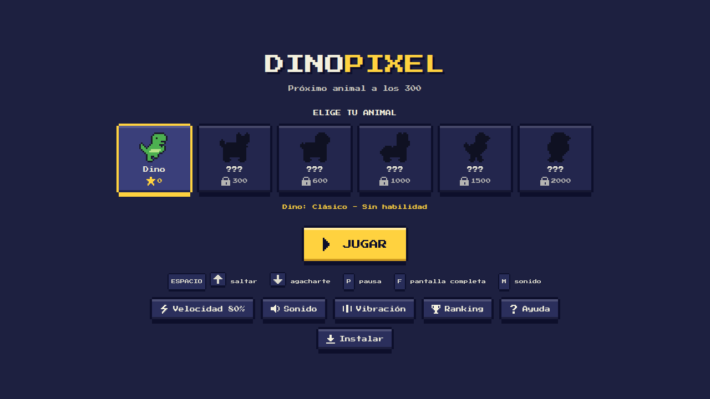
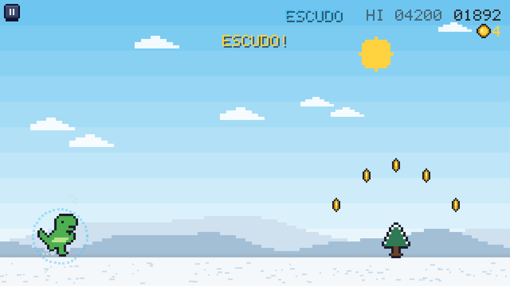

# DinoPixel

*[Español](README.md) · English*

**[Play now: dinopixel-game.vercel.app](https://dinopixel-game.vercel.app/)**

A run-and-jump game in the style of Chrome's dinosaur, in full-color pixel art, with **9 unlockable animals**, each
with its own ability. It runs in the browser and can be installed as a **PWA** (works offline). No dependencies and
no build step: plain HTML, CSS and JavaScript. The game is available in **Spanish and English**.

| Menu | In game |
|---|---|
|  |  |

## How to play

| Action | Keyboard | Touch |
|---|---|---|
| Jump | `Space` / `↑` / `W` | Tap the screen |
| Shorter jump | Let go of the key early | Short tap |
| Pause | `P` / `Esc` | ⏸ button |
| Fullscreen | `F` | Turns on when you press PLAY |
| Sound effects | `M` | Menu button |
| Music | `N` | Menu button |

There is only one action: **jump** (hold to jump higher). Jump over ground obstacles and low and middle birds (the
middle ones a bit higher); you can run under high birds without doing anything. Day turns to night every 700
points, and the speed grows with the score: fast at first and then more and more slowly, getting close to the
maximum around four minutes into a run (half of the increase arrives at about a minute and a half).

**Moving obstacles:** from 800 points, about 1 in 4 ground obstacles moves faster than the ground, so it arrives
sooner: a bouncing **tumbleweed** (desert), a **snowball** (snow), a **car** (city), a bouncing **coconut**
(jungle) and a rolling **boulder** (volcano). They are never taller than a small cactus, and the game caps their
speed so they never catch up with the obstacle ahead and make an impossible combo.

**Coins and items:** coins give 10 points and appear in an arc over some cacti (you grab them by jumping) or in a
row after an obstacle, at ground level or up high. From 400 points a **shield** (takes one hit, with any animal;
they stack) and a **magnet** (pulls in nearby coins for 6 s) show up now and then. A counter under the score shows
the coins of the run, and the **wallet** in the corner of the menu shows the coins you can spend.

**Shop:** coins are spent in the **Shop** (menu button, or tap the wallet): unlock an animal before reaching its
score (it costs its score divided by 10: cat 100, …, turtle 800), buy **colors** (Gold, Shadow, Ice, Bubblegum;
300 each) or **hats** (Cap 150, Top hat 250, Cowboy 300, Santa 400, Crown 600). Colors and hats are bought once,
work on every animal and you choose which one each animal wears; they show in the game and in the menu. Spending
coins does not take away progress from the coin achievements.

**Daily challenge:** there is a different challenge each day (the same all day, renewed at midnight): reach X
points with an animal, collect X coins, dodge X birds or obstacles, or last X seconds, always in one run. It gives
50–70 coins, +10 for each day of streak (up to +50). It shows in the **Daily** button of the menu and on the
start screen of a run. Prize coins can be spent, but they don't count for the coin achievements.

**Stats:** a tab inside **Achievements** with runs, time played, best score, jumps, dodges, coins collected and
spent, and each animal's record.

**Zones:** every 1500 points the scenery changes, with a color transition and a notice: **Desert** (cacti),
**Snow** (snowmen and pine trees), **City** (cones and fire hydrants, with buildings in the background),
**Jungle** (bushes and stumps) and **Volcano** (rocks and lava rocks). Then it goes back to the desert. All ground
obstacles are the same size, so the landscape changes, not the difficulty.

## Halloween (October 24 to November 2)

During those days the game dresses up by itself:

- **Atmosphere:** birds become **bats**, coins become **candies**, **pumpkins** show up among the cacti, and night
  comes sooner (at 350 points), purple, with a full orange moon. The menu turns purple and orange, with bats,
  pumpkins and a *Happy Halloween!*.
- **Graveyard zone:** a sixth zone after the volcano, with tombstones and pumpkins, a floating **ghost** as its
  moving obstacle and its own spooky song.
- **Seasonal shop:** **Witch** (250) and **Pumpkin** (350) hats, and **Zombie** and **Ghost** colors (300). They are
  only on sale those days, but whatever you buy stays forever.
- **Special challenge on the 31st:** *Trick or treat*, collect 31 candies in one run (100 coins).
- ***Trick or treat* achievement:** collect 100 candies at Halloween.

To try it out of season: `?season=halloween` in the URL (and `?season=off` to turn it off).

## Animals and abilities

You start with the dino; the rest unlock with your **best score** (with any animal): a new one every 1000 points.

| Animal | Points | Ability |
|---|---|---|
| Dino | 0 | Classic, no ability |
| Cat | 1000 | **Double jump**: a second jump in the air |
| Dog | 2000 | **Shield**: starts every run with a shield (added to the ones it picks up); only that one counts for the *Iron shield* achievement |
| Bunny | 3000 | **High jump** |
| Chicken | 4000 | **Glide**: hold while falling |
| Penguin | 5000 | **Skater**: scores 50 % more points |
| Frog | 6000 | **Super jump**: charges by itself while running on the ground; after ~¾ s without jumping, the next jump is much higher (a yellow bar above it tells you) |
| Fox | 7000 | **Dodge**: passes through the first bird that hits it; then recharges in 8 s (orange bar = ready) |
| Turtle | 8000 | **Shell**: birds can't hurt it, but the game runs 15 % slower (and it scores fewer points) |

Records are saved per animal in the browser (`localStorage`).

## Achievements

25 achievements with an on-screen notice when you earn them and an **Achievements** screen (menu button) with the
progress of each one. Among them: scores (500 to 7000), runs played, jumps, obstacles and birds dodged, coins (100
and 1000), lasting 2 minutes, one per ability (cat's double jump, dog's shield, chicken's glide, penguin's slide),
1500 with every animal, unlocking all 9, reaching the top 3 of the ranking, being number 1 of the week, completing 7
daily challenges, sharing and collecting 100 candies at Halloween. They are saved in the browser (`localStorage`); the ones you already meet when you
open the game are marked by themselves, without notices.

## Settings

- **Pause**: Resume, speed, volume, fullscreen, ranking, achievements, help and back to the menu.
- **Speed** (60–100 %): slows the whole game down evenly. Defaults to 100 % on phones and 80 % on computers.
- **Volume** (menu and pause button): 25, 50, 75 or 100 %, for music and effects at once, with a beep so you can hear
  the level. It is remembered.
- **Sound effects** (`M`): sounds generated with WebAudio (no audio files). A soft tick every 500 points (with a
  blink of the score), an arpeggio when you earn an achievement and a fanfare when you unlock an animal.
- **Music** (`N`): chiptune generated live, without audio files, so it works offline. Each zone has its own song,
  with a day and a night version: the desert in a major key (minor at night), the snow calm with a little-bell
  melody, the city faster with an eighth-note bass and a kick on every beat, the jungle cheerful with a marimba
  melody, and the volcano low and dark, the fastest one. The tempo rises with the game's speed (and with the speed
  setting), and the hi-hat and kick come in as it gets faster. It pauses with the pause and stops when you die; the
  menu is silent. Effects and music are turned on separately and remembered.
- **Vibration**: Android only (the button doesn't show on iPhone: Safari doesn't allow web pages to vibrate).
- **Language**: Spanish or English. It is picked from the browser's language and changed with the
  *English* / *Español* button in the menu.
- **Ranking**: *Ranking* button in the menu and the pause screen (see below), with an option to delete your data.
- **Help**: *Help* button in the menu and the pause screen (or the `H` key), with controls, animals and tips.

## Cloud save

**Save** button (cloud) in the menu. When you turn it on, the server gives you a **recovery code**
(`XXXXX-XXXXX`): with it you can get your progress back on another phone or after clearing the browser data. No
accounts or passwords.

- **What is saved:** records, coins, purchases, colors, hats, achievements, stats, the daily challenge streak, the
  nickname and your ranking identity. Device settings (speed, volume, music, effects, vibration, language) are not
  saved.
- **When:** by itself after every run, when buying in the shop, when changing your nickname and when closing the
  app; and with *Save now*.
- **Restore** replaces the progress on the device (with double confirmation). If you play on two phones at once
  with the same code, the last saved run wins.
- **Privacy and security:** the server doesn't store the code, only a hash of it; loading is limited to 20 tries per
  hour and IP so codes can't be guessed; *Delete server copy* removes it, and if unused it expires after ~13 months.

Endpoints: `POST /api/save` (`{ data }` creates, `{ code, data }` updates, `{ code, delete: true }` deletes) and
`POST /api/load` (`{ code }`).

## Global ranking

Online ranking with a **nickname**, in two periods: **Week** (resets by itself every Monday at 00:00 UTC, with a
countdown) and **All time**. Each has a global board and one per animal (top 20 and your position), and each row
shows the icon of the animal that set the score. It opens from the *Ranking* button in the menu or the pause
screen; when you die, the game shows your position.

- **How it works:** Vercel functions in [api/](api/) (no dependencies) store the scores in
  [Upstash Redis](https://upstash.com/) through its REST API. Only your nickname (always in capitals), a random id
  and your best score are stored (the IP is used briefly to limit submissions and is not stored).
- **Offline:** the score is kept and sent when the network comes back. If the ranking isn't set up, the game works
  the same and the ranking screen says it isn't available.
- **Cheating:** there is no perfect protection in a browser game. The server signs each run when it starts, checks
  that the elapsed time matches the score, accepts each run only once, limits submissions per player and IP and
  filters nicknames. It stops casual cheating, not someone determined.

**Turning it on in Vercel** (once):

1. In the Vercel project: *Storage → Create Database → Upstash (Redis)*. The **Free** plan is more than enough.
2. Connect it to the project. Vercel creates the `KV_REST_API_URL` and `KV_REST_API_TOKEN` variables
   (`UPSTASH_REDIS_REST_URL` and `UPSTASH_REDIS_REST_TOKEN` also work).
3. Redeploy. Optional: set `SCORE_SECRET` to sign runs with your own key.

Endpoints: `GET /api/start`, `POST /api/score`, `GET /api/ranking?board=all|dino|cat|dog|bunny|chick|peng`,
`POST /api/name`, `POST /api/delete`. `ranking` accepts `period=week|all`.

**Privacy:** only your nickname (in capitals), your best score and a random id generated on your device are stored.
The *Delete my data* button on the ranking screen (with double confirmation) removes your nickname and your scores
from every board and generates a new id. Ranking queries are rate-limited per IP to keep costs down.

## Tests

No dependencies: Node 22+ and Chrome/Chromium.

```bash
node tests/run.mjs        # syntax + API tests + game tests in Chrome (~1 min)
node tests/api.test.mjs   # API only (validation, anti-cheat, weekly ranking, deletion, limits)
node tests/ui.test.mjs    # game only (menu, run, abilities, achievements, ranking, PWA, languages)
```

The tests start a mock Redis and a local server that runs `api/*.js` like Vercel does, and drive Chrome through
DevTools. The game exposes `window.__dp` only when the URL has `?test=1`. If Chrome isn't on the `PATH`, set
`CHROME_BIN`. GitHub Actions ([.github/workflows/test.yml](.github/workflows/test.yml)) runs them on every push.

## Sharing

When you die a **Share** button appears: it opens the phone's share menu (or copies the text and link to the
clipboard on desktop). The game link shows a preview with an image on WhatsApp, Telegram and social networks
(`og-image.png`, made from the game itself).

## Running it locally

```bash
python3 -m http.server 8080
# open http://localhost:8080
```

It has to be served over `http://localhost` (or HTTPS): the service worker doesn't work when opening the file with
`file://`. With this server the ranking shows as unavailable; to try it locally you need `vercel dev` with the
Upstash variables.

## Deploying to Vercel

It is a static site: in Vercel choose the **Other** preset, with no *Build Command* or *Output Directory*.
[vercel.json](vercel.json) already sets the cache headers for `sw.js` and the manifest.
The project includes **Vercel Analytics**; turn it on in the project's *Analytics* tab.

## PWA: releasing a new version

The service worker stores the files in a named cache. For players to get a change and see the **"New version"**
notice, bump the `CACHE` number in [sw.js](sw.js) on every release:

```js
const CACHE = 'dinopixel-v71';   // -> 'dinopixel-v72', ...
```

Install notes:

- **Android (Chrome):** ⋮ menu → *Install app*. It opens in landscape without browser bars.
- **iPhone/iPad:** Safari → Share → *Add to Home Screen*. iOS doesn't allow locking the orientation or vibrating;
  if the phone is upright, the game asks you to turn it.
- If you had installed an old version as a shortcut, delete it and install it again.

## Structure

```
index.html      menu, game stage, overlays and preview tags (Open Graph)
style.css       pixel interface (bevelled buttons, icons, phone/notch layout)
js/             the game, split by topic and loaded in this order:
  i18n.js         language (Spanish/English) and page translation
  sprites.js      constants, animal and obstacle sprites
  helpers.js      utilities, day/night palettes and zones
  canvas.js       canvas at native resolution and notch margins
  audio.js        effects, chiptune music and vibration
  progress.js     unlocks, achievements and abilities
  engine.js       state, obstacles, physics and collisions
  render.js       game drawing and pixel font
  controls.js     icons, volume, speed, loop, pause and input
  screens.js      help, sharing and achievements
  ranking.js      online ranking
  daily.js        daily challenge
  cloud.js        cloud save (recovery code)
  menu.js         menu, settings, install, PWA and test hook
sw.js           service worker (cache, new version notice)
api/            ranking functions (Vercel Functions + Upstash Redis)
tests/          automated tests (API and browser)
manifest.json   PWA data
icons/          app icons
fonts/          Press Start 2P (OFL license)
docs/           README and manifest screenshots
og-image.png    preview image when sharing the link (1200x630)
```

How it's made, in case you want to tinker with it:

- **Sprites** defined as text in [js/sprites.js](js/sprites.js) (`ANIMALS`), with an automatic outline. To add an
  animal, copy an entry and define its body, legs and ability.
- **Translations**: every text is written as `L('español', 'English')`; static HTML carries its English version in
  `data-en*` attributes ([js/i18n.js](js/i18n.js)).
- **Native resolution**: the canvas uses the screen's real pixels with an integer scale, so the pixel art looks sharp
  at any density.
- **Pixel text and icons** drawn from bitmaps, without images.

## License

The code and art of this project are released under the [MIT](LICENSE) license. The Press Start 2P font (in
`fonts/`) keeps its own license, the [SIL OFL 1.1](fonts/OFL.txt).

## Credits

- [Press Start 2P](https://fonts.google.com/specimen/Press+Start+2P) font by CodeMan38, under the
  [SIL Open Font License 1.1](fonts/OFL.txt).
- Inspired by Chrome's offline dinosaur. All art and code in this project are original.
